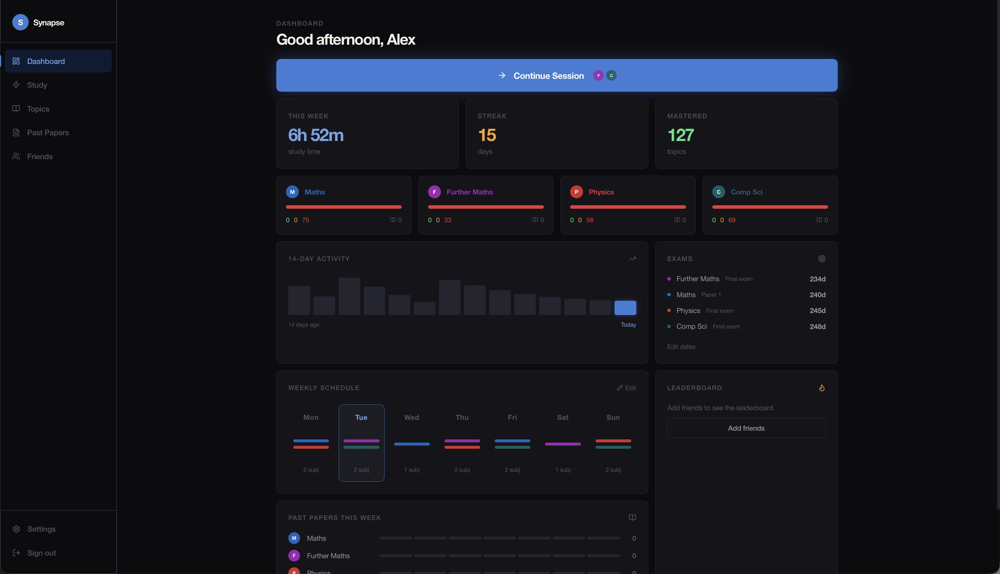
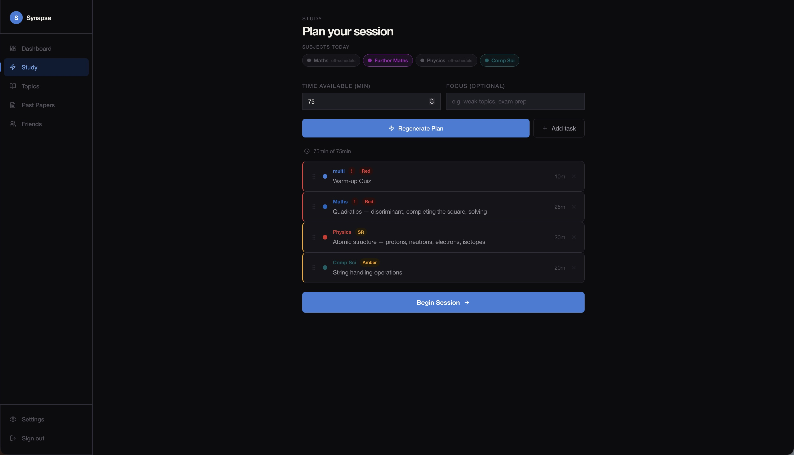
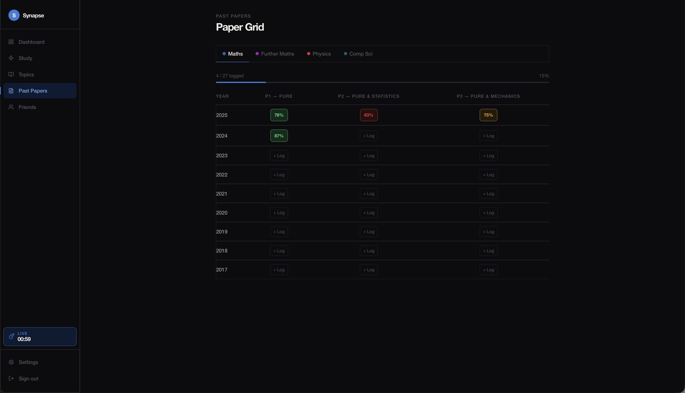
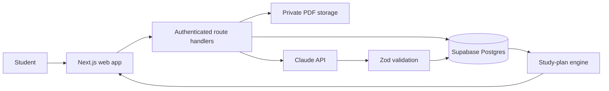

# Synapse

### A specification-aware study centre for UK A-level students

Synapse is a self-initiated full-stack software project that turns a student's syllabus, confidence ratings, past-paper history and available time into a focused revision workflow.

I built it to solve a problem I knew first-hand: revision tools are often good at storing material, but poor at deciding **what to study next**. Synapse brings planning, practice, marking and progress tracking into one system.

> **Portfolio status:** active development. This public repository is a technical case study; the application source and live student data are kept private.

[Project overview](#project-overview) · [Engineering](#engineering-highlights) · [Architecture](docs/ARCHITECTURE.md) · [Security](docs/SECURITY.md) · [Sources](CITATIONS.md)

---

## Product walkthrough

### 1. Dashboard

The dashboard brings together current streak, weekly study time, upcoming examinations, subject-level confidence and the day's schedule.

### 2. Adaptive study plan

The planner allocates a time budget across scheduled subjects. It prioritises overdue spaced-repetition items and lower-confidence subtopics, avoids unnecessary repetition from recent sessions, and lets the student override or reorder the result.

### 3. Guided study session

A session combines a persistent timer, warm-up questions drawn from previous mistakes, topic blocks, exam-style questions and end-of-block reflection. The student's rating feeds the next review interval.

**[Watch the Synapse product walkthrough](assets/demo/synapse-walkthrough.mov)** · MOV · 17 MB

### 4. Past-paper workflow

Students can catalogue attempts, upload answer PDFs and mark schemes, record scores and traffic-light confidence, and keep short recap notes. The server-side marking flow verifies ownership before processing documents and validates model output before it is stored.

---

## Project overview

### The problem

Students usually have syllabus documents, flashcards, calendars and past papers in separate places. That creates three recurring decisions:

1. What should I revise today?
2. How should I divide the time I have?
3. How do mistakes change tomorrow's plan?

Synapse treats those decisions as one feedback loop rather than a collection of unrelated tools.

### The approach

The system combines:

- **Specification-aware subject maps** based on official AQA, Pearson Edexcel and OCR qualification structures.
- **RAG confidence tracking** at subtopic level: red, amber or green.
- **Spaced review scheduling** driven by the student's most recent rating.
- **Time-boxed planning** using the day's subjects, confidence weights, due reviews and recent activity.
- **Exam practice** with a past-paper catalogue, answer uploads, score history and recap notes.
- **AI-assisted workflows** for question generation and PDF marking, with schema validation and server-side access checks.
- **Reflection and accountability** through a study diary, activity history and a deliberately limited friends leaderboard.

## Engineering highlights

### Adaptive planning

The planner is deterministic where it matters. It calculates weights from confidence state, gives due spaced-repetition work priority, accounts for a user-supplied time budget, and avoids repeating recently studied material. AI is used for bounded content tasks rather than for the core allocation logic.

### Defensive AI integration

Model output is treated as untrusted input. Generated questions and marking results are parsed into explicit schemas before persistence. The marking route also checks authentication, verifies file ownership, applies a per-user rate limit and only retrieves documents on the server.

### Data modelling through migrations

The backend has grown through more than 50 incremental SQL migrations covering authentication-linked profiles, subject progress, spaced-repetition sessions, calendars, files, marking jobs, flashcards, notes, diary entries, friendships, question banks and generated study plans.

### Privacy by design

Student data is isolated using PostgreSQL Row Level Security and explicit `user_id` filters. Uploaded PDFs are checked by file signature and size, stored beneath user-specific paths and served through authenticated routes. Social features expose study duration—not private reflections—to accepted friends.

### Accessible interaction details

The interface includes visible keyboard focus, reduced-motion handling, semantic controls, loading states and restrained animation. The visual language uses a dark neutral base with subject colours inspired by transit lines, making progress states easy to scan.

## Architecture at a glance

See [Architecture](docs/ARCHITECTURE.md) for the main data flows and trade-offs.

## Technology

| Layer | Choice | Why it fits |
|---|---|---|
| Web application | Next.js 14, React 18, TypeScript | Server/client composition and typed route handlers |
| Interface | Tailwind CSS, Radix UI, Framer Motion | Consistent components, accessible primitives and focused motion |
| Backend | Supabase Postgres, Auth and Storage | Relational modelling with database-enforced row policies |
| AI | Anthropic SDK | PDF-aware marking and bounded generation tasks |
| Validation | Zod | Runtime validation at untrusted boundaries |
| Workspace | pnpm and Turborepo | Shared types and repeatable monorepo tasks |

## What I learned

- Personalisation is most useful when its rules are inspectable. The planner became easier to test and explain after separating deterministic prioritisation from generative content.
- Authentication is not authorization. Every user-owned read and mutation needs an ownership boundary at both application and database level.
- AI features need ordinary software safeguards: rate limits, schema validation, error states and recovery paths.
- A curriculum model changes over time. Stable IDs and incremental migrations matter when topic structures, option modules and paper catalogues evolve.
- Product work is iterative. The most valuable improvements came from tightening the study loop—not from adding isolated features.

## Current limitations and next steps

- Add a repeatable automated test suite around the planner, spaced-repetition rules and authorization boundaries.
- Add observability for AI latency, failure rate and cost without logging student content.
- Run structured usability testing with students and evaluate whether generated plans improve adherence.
- Complete accessibility testing with keyboard-only, screen-reader and contrast checks.
- Add a public demonstration environment containing synthetic data only.

## Repository purpose

This repository documents the project for portfolio and recruitment use. It intentionally does not contain credentials, student data, proprietary model prompts or the private application repository.

For the authoritative references behind the qualification maps and technical decisions, see [CITATIONS.md](CITATIONS.md).

## Author

Built and designed by **Oscar Horton**.

## Rights

Copyright © 2026 Oscar Horton. All rights reserved. Third-party names and product marks belong to their respective owners. Synapse is an independent student project and is not affiliated with, endorsed by or sponsored by any examination board or technology provider.
