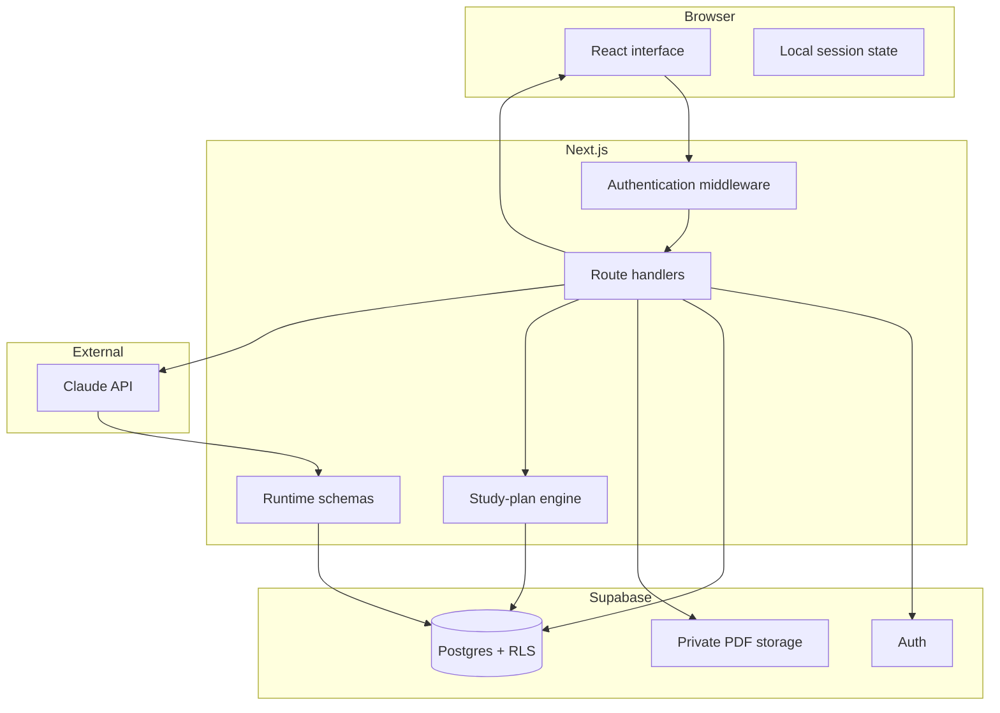
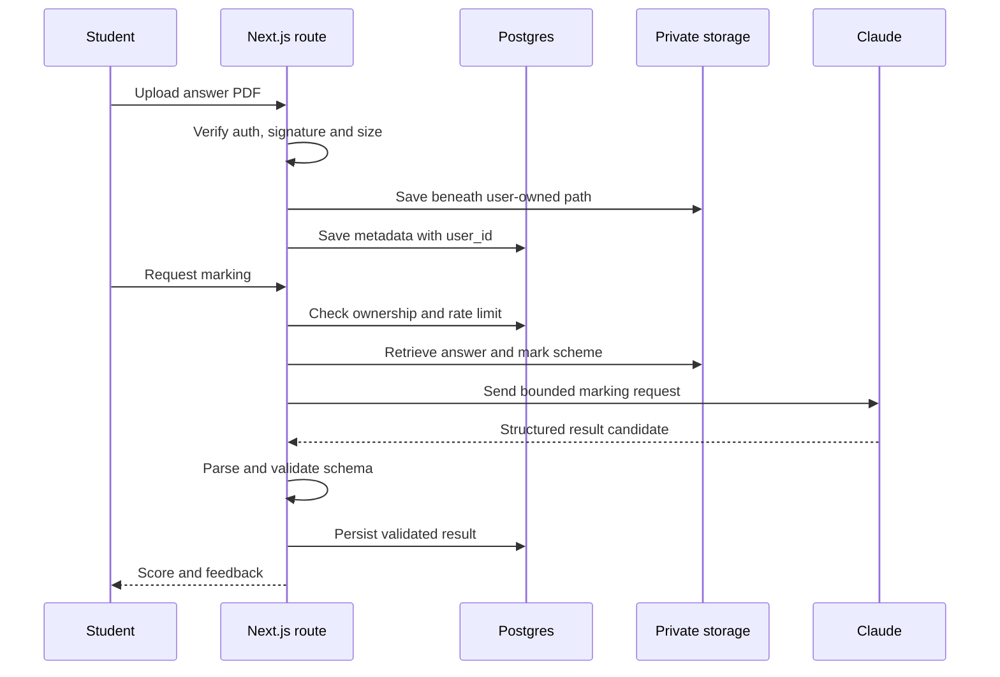

# Architecture

This document describes the current web implementation of Synapse. It focuses on the design decisions most relevant to a technical reviewer; infrastructure details and credentials are intentionally omitted.

## System boundary

## Main workflows

### Study-plan generation

1. Authenticate the request and validate the requested time budget.
2. Load enrolled subjects, the day's schedule or override, subtopic confidence, due reviews, recent plans and missed questions.
3. Weight each subject according to the amount of red and amber material.
4. Reserve time for due reviews, then score candidate subtopics by confidence and the student's optional focus.
5. Suppress recent repetition unless an item is due or still red.
6. Prepend a warm-up block when the question bank contains mistakes.
7. Persist a bounded list of timed blocks for the day.

The planner deliberately uses deterministic rules. This makes the result explainable and avoids delegating basic scheduling decisions to a language model.

### PDF marking

### Spaced review

A pure TypeScript function maps the student's rating to a traffic-light state and calculates the next review date. The interval and ease factor are updated from explicit rules, so the behaviour can be unit-tested without a database or UI.

## Data model

The schema is migration-driven. Major groups include:

- identity and profiles;
- enrolled subjects and exam dates;
- subtopic confidence and spaced-repetition sessions;
- study plans, blocks and day overrides;
- files, annotations, paper catalogues and paper attempts;
- generated questions, marking jobs and flashcards;
- notes, diary entries, friendships and leaderboards.

## Design trade-offs

### Static specification data

Qualification structures are stored as typed application constants. This gives fast, predictable reads and stable IDs. The trade-off is that syllabus updates require a code change and source review.

### Direct Supabase access plus RLS

Some authenticated reads can use the Supabase client directly, while privileged file operations remain server-side. Database row policies provide a second authorization boundary. This reduces backend boilerplate but makes policy review and testing essential.

### Model output parsing

The application currently extracts JSON from model text and validates it with Zod. Validation prevents malformed data reaching storage; a future iteration should use provider-native structured output wherever supported and add retry/repair telemetry.

### Incremental schema evolution

Small ordered migrations preserve the project's development history and make changes reviewable. The trade-off is that older migrations need periodic consolidation and regression testing before production-scale use.
